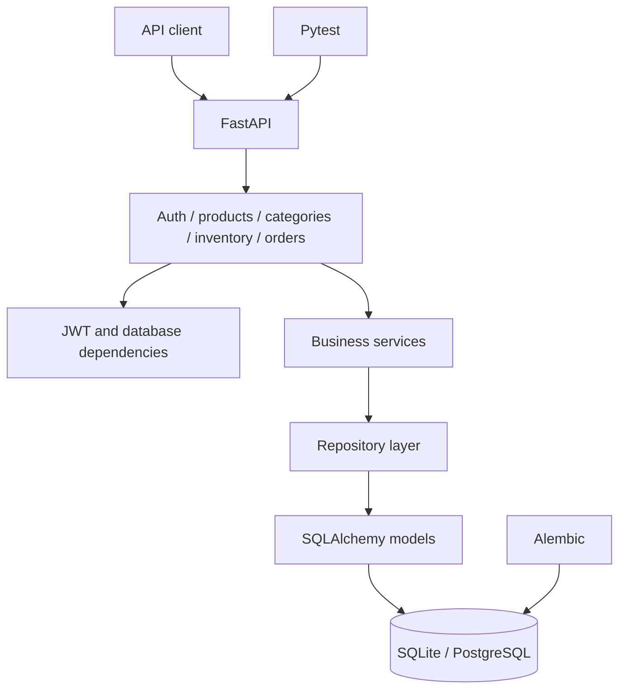

# InventoryX — Architecture

Routers handle HTTP concerns, dependencies provide authentication and sessions, services implement inventory/order rules, repositories perform persistence, and Alembic versions schema changes.
